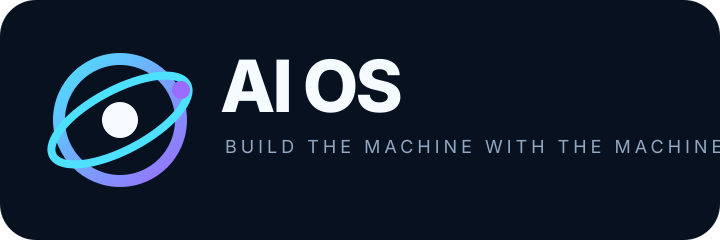

<div align="center">
  
  <h1>AI OS</h1>
  <p><strong>An emulator-first operating system that grows with its agent.</strong></p>
  <p>
    <a href="https://github.com/noktirnal42/ai-os/actions"></a>
    <a href="https://github.com/noktirnal42/ai-os/blob/main/LICENSE"></a>
    <a href="https://github.com/noktirnal42/ai-os/issues"></a>
  </p>
</div>

AI OS is a controlled experiment in machine-built software. It starts with a
minimal Alpine aarch64 guest, a bounded agent harness, and a human in the loop.
The agent can write and test new software inside `/ai`; every capability is
observable, checkpointable, and evaluated before it becomes part of the system.

> **Status:** AI OS runs in the emulator with a beginner-facing terminal console.
> Chat mode answers questions without tools; Do mode runs bounded tasks and
> shows tool progress, model waits, and verification results. This is research
> software, not a general-purpose operating system.

## Why this exists

Most agent demos stop at a chat window. AI OS asks a harder question: can an
agent build a useful environment while the environment keeps the agent bounded?
The project treats the emulator as the lab bench and makes the evidence part of
the product.

```text
human intent → model → bounded tools → compiled software → tests → checkpoint
                    ↘ audit log / evaluator / approval gate ↗
```

## What works today

| Layer | Current slice |
| --- | --- |
| Emulator | Alpine aarch64 on QEMU/HVF, driven only through `emulation/vm.sh` |
| Harness | Python agent loop, OpenAI-compatible model client, JSONL audit sessions |
| Tools | shell, file read/write, process, registry, checkpoint, human approval |
| Apps | calculator, file utilities, jobs, line editor, offline ask command |
| Safety | `/ai` path policy, secret denial, network gate, output/time limits |
| Evidence | unit tests, app acceptance tests, repeatable evals, sandbox probes |
| Live model | Ollama OpenAI-compatible endpoint with `qwen2.5-coder:3b` |

## Quickstart: talk to AI OS

On an Apple Silicon Mac, install QEMU and Ollama, then install at least one local
model. The recommended starter model is about 2 GB; AI OS will not download model
weights without asking:

```bash
brew install qemu ollama
ollama pull qwen2.5-coder:3b
```

From macOS Terminal in this repository, run:

```bash
./emulation/start.sh
```

The launcher checks the host, verifies or creates the emulator, starts it when
needed, syncs the current console, detects a local Ollama model, and opens the
interactive terminal UI. On first launch it downloads the Alpine guest image;
that image is checksum-verified. If Ollama is installed but stopped, the
launcher starts its local service. It never installs Ollama or downloads model
weights without an explicit command.

In the console, type a question in **Chat** mode. Press **F2** to switch to
**Do** mode, describe a task, and press Enter. Do mode shows each tool action,
long model waits, approvals, failures, and completion. **F1** shows help; **Ctrl-C**
or **Esc** exits. The task runner has a 32-tool / 15-minute budget; model
requests may take up to five minutes. If no model is found, the launcher prints
the exact setup command instead of starting a silent session.

To launch from the guest shell directly after setup:

```sh
aios tui
```

For a non-interactive first-run check, or to operate the VM separately:

```bash
emulation/vm.sh doctor
emulation/vm.sh status
emulation/vm.sh exec 'uname -m && ls /ai'
```

Run the host-side checks:

```bash
make -C ai test calc-test fileutils-test jobs-test aed-test ask-test
AIOS_ROOT="$(mktemp -d)" make -C ai eval
AIOS_ROOT="$(mktemp -d)" make -C ai sandbox-probes
```

With Ollama reachable on the Mac host, pass the endpoint explicitly:

```bash
emulation/vm.sh exec \
  'AIOS_MODEL_URL=http://10.0.2.2:11434 AIOS_MODEL=qwen2.5-coder:3b \
   /ai/bin/aios ask "Reply with exactly LIVE_MODEL_OK"'
```

The full VM contract and recovery workflow are in
[docs/13-EMULATION-PLATFORM.md](docs/13-EMULATION-PLATFORM.md). The harness
walkthrough is in [ai/README.md](ai/README.md), and the latest evidence is in
[ai/VALIDATION.md](ai/VALIDATION.md).

## Roadmap

- **Phase 1 — live:** bounded harness, core apps, evals, checkpoints.
- **Phase 2 — next:** richer process supervision, capability manifests, and a
  model-driven app install flow with explicit human gates.
- **Phase 3:** networking as a separately approved capability and a cloud-model
  bridge with provenance and cost controls.
- **Later:** graphical shell, browser, hardware bring-up, and reproducible
  releases only after emulator evidence earns them.

## Join the build

The best contributions make the system easier to understand and harder to
accidentally widen. Start with a reproducible bug, a deterministic app, a
security boundary, or an evaluation fixture. Read
[CONTRIBUTING.md](CONTRIBUTING.md), then open an issue or a focused pull request.

## Project map

- [`AGENTS.md`](AGENTS.md) — contributor and emulator contract
- [`docs/`](docs/) — architecture, requirements, security, and roadmap
- [`emulation/`](emulation/) — VM lifecycle and provisioning
- [`ai/`](ai/) — harness, apps, tests, and evals

## License

Released under the [MIT License](LICENSE).
